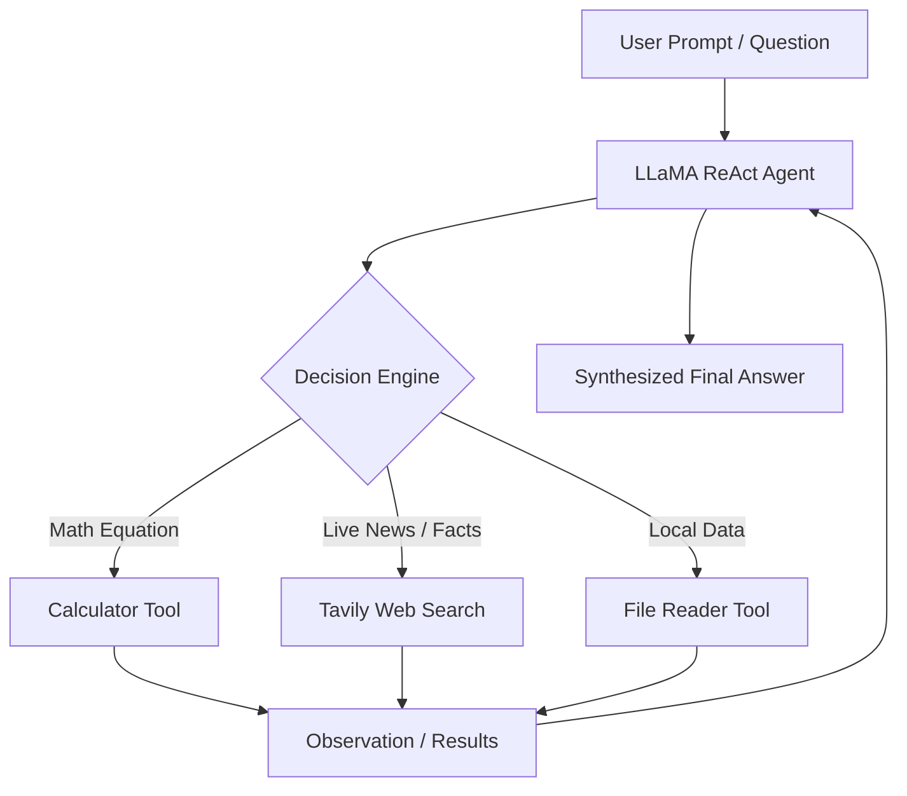

# 🦙 LLaMA ReAct Agent with Live Web Search & Tools

An interactive, agentic AI assistant implementing the **ReAct (Reasoning + Acting)** paradigm. Powered by **Local Ollama LLaMA-3**, **LangChain**, **Tavily Web Search**, and **Streamlit**.

---

## 🌟 Overview

The **LLaMA ReAct Search Agent** solves complex, multi-step queries by reasoning step-by-step through a Thought-Action-Observation loop. When presented with questions requiring live facts, mathematical computations, or local file access, the agent autonomously selects and executes the appropriate tool before synthesizing a final grounded answer.



---

## ✨ Features

- **🧠 Transparent ReAct Loop:** Exposes full agent reasoning traces (Thoughts, Actions, Action Inputs, and Observations) directly in the UI.
- **🌐 Real-Time Web Search:** Powered by **Tavily AI Search API** for up-to-date information retrieval and source URL attribution.
- **➗ Sandboxed Math Calculator:** Safely evaluates arithmetic expressions, exponents, square roots, and trigonometric calculations.
- **📂 Local File Inspector:** Inspects local text files and documents on demand.
- **💬 Conversational Memory:** Uses a sliding buffer window (`ConversationBufferWindowMemory`) to retain multi-turn context.
- **🖥️ Modern Streamlit UI:** Clean chat interface with collapsible reasoning expanders, conversation reset, and customizable Ollama endpoint configuration.

---

## 🛠️ Tech Stack

| Component | Technology |
|---|---|
| **Language Model** | [Ollama](https://ollama.com/) (LLaMA-3 / LLaMA-3.1 / Mistral) |
| **Agent Framework** | [LangChain](https://www.langchain.com/) |
| **Web Search API** | [Tavily](https://tavily.com/) |
| **User Interface** | [Streamlit](https://streamlit.io/) |
| **Language** | Python 3.10+ |

---

## 🚀 Getting Started

### 1. Prerequisites

- Python 3.10 or higher
- [Ollama](https://ollama.com/) installed and running locally
- A free [Tavily API Key](https://app.tavily.com/)

### 2. Pull the Ollama Model

```bash
ollama pull llama3
```

Ensure Ollama is running in the background (`ollama serve`).

### 3. Installation

Clone this repository and install dependencies:

```bash
git clone https://github.com/tasneemibrahim-ai/Llama-ReAct-Search-Agent.git
cd Llama-ReAct-Search-Agent
pip install -r requirements.txt
```

### 4. Configure Environment

Create your `.env` file from `.env.example`:

```bash
cp .env.example .env
```

Add your Tavily API key:

```ini
TAVILY_API_KEY=tvly-your_tavily_api_key_here
```

### 5. Launch the Application

```bash
streamlit run streamlit_app.py
```

Or run via the CLI interface:

```bash
python main.py
```

---

## 💡 Example Queries to Try

1. **Multi-Step Search & Calculation:**
   > *"Search for the current population of Tokyo and New York, sum them, and calculate 15% of the total."*
2. **Real-Time News:**
   > *"What are the latest updates and announcements from OpenAI this week?"*
3. **Compound Math:**
   > *"Calculate 23% of 4,750 and then find its square root."*

---

## 📂 Project Structure

```
Llama-ReAct-Search-Agent/
├── agent.py            # ReAct agent builder and execution loop
├── tools.py            # Custom tools (Calculator, WebSearch, FileReader)
├── memory.py           # Conversational buffer memory manager
├── main.py             # Interactive CLI entrypoint
├── streamlit_app.py    # Streamlit web application with step visualizer
├── requirements.txt    # Python dependencies
├── .env.example        # Environment variable template
├── .gitignore          # Git exclusion rules
└── README.md           # Project documentation
```

---

## 👨‍💻 Author

**Tasneem Ibrahim**  
- GitHub: [@tasneemibrahim-ai](https://github.com/tasneemibrahim-ai)
